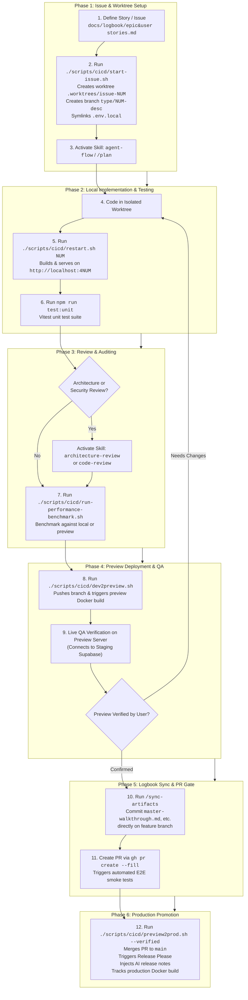
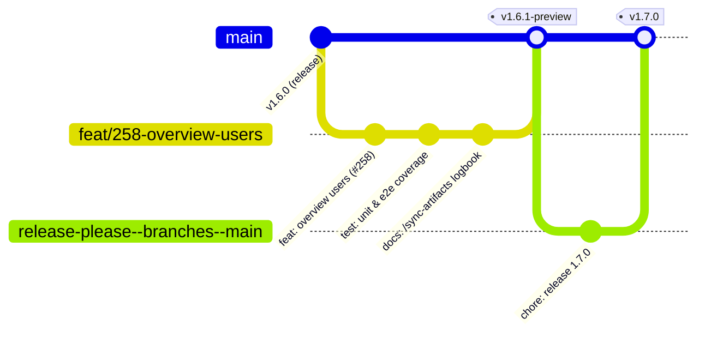

# Software Development Life Cycle (SDLC), Git & CI/CD Workflow

This document outlines the standard **GitHub Flow** and development methodology tailored specifically for the **Sacred Fire Songs** architecture. It integrates our developer CI/CD scripts, AI agent skills, branch protections, worktree isolation, preview validation gates, and Release Please automation.

---

## 1. End-to-End Workflow Diagram

The flowchart below demonstrates the progression across all development phases, highlighting the scripts and agent skills to trigger at each step:

---

## 2. Git Lifecycle & Branching (`gitGraph`)

The project enforces strict branch isolation: **never commit directly to `main`**, and **always sync logbook artifacts directly to the feature branch before merging**.

---

## 3. Phase-by-Phase Reference Matrix

| Phase | Instance / Trigger | Recommended Script | Recommended Agent Skill / Command | Key Rules & Policies |
|---|---|---|---|---|
| **1. Issue & Branch Init** | Starting any new story, fix, or chore | `./scripts/cicd/start-issue.sh <issue> <type> <desc>` | `/start-story` or `/plan` | **Never work directly on `main`**. Scripts auto-creates `.worktrees/issue-<NUM>` and symlinks `.env.local`. |
| **2. Feature Dev** | During active development | Local editor / shell | `agent-flow` (Phases 1-4: Discovery, Planning, Assembly, Implementation) | Maintain documentation sync (`sync-policy.md`). |
| **3. Local Verification** | Feature complete, before pushing | `./scripts/cicd/restart.sh <issue>` `npm run test:unit` | `agent-flow` (Phases 5-6: Verification, Self-Correction) | Port `4<issue>` avoids collisions; verify with unit & parser tests. |
| **4. Architectural Audit** | Complex refactors or before PR | `npm run test:perf` | `architecture-review` `code-review` | Checks boundary bleed, LoB, DRY vs abstraction, security. |
| **5. Preview Deployment** | Ready for real-network / hardware QA | `./scripts/cicd/dev2preview.sh` | — | Preview points to **Staging Supabase**. If empty, verify staging DB is active. |
| **6. User Verification** | Preview site is live | Manual browser inspection | — | **Preview Verification Rule**: Never merge to `main` without explicit confirmation. |
| **7. Artifact Sync** | **Before** opening PR | `node scripts/cicd/sync-stories-to-gh.mjs` | `/sync-artifacts` | **Feature Branch Logbook Sync**: Commit logbook files directly on the feature branch, never on `main`. |
| **8. Pull Request** | Ready for review & automated E2E | `gh pr create --fill` | — | Triggers automated Playwright E2E smoke tests in GitHub Actions. |
| **9. Production Release** | User confirms preview verification | `./scripts/cicd/preview2prod.sh --verified` | — | Enforces Verification Gate, merges PR, triggers Release Please, injects AI notes. **No-Latest tag rule**. |

---

## 4. Key Rules & Operational Policies

### Verification Rule
- **Preview Deployment Verification**: Always verify the finished development on the preview website before merging any branch to `main`. Do not merge automatically without explicit user confirmation of verification.
- **NEVER Auto-Merge**: NEVER merge a Pull Request to `main` without explicit, unambiguous permission.
- **NEVER Auto-Close Issues**: NEVER use the GitHub CLI or APIs to close issues without explicit instruction.

### Artifact Synchronization Policy
- **Feature Branch Logbook Sync**: Always commit logbook artifact updates (`master-walkthrough.md`, `master-tasks.md`, `master-timetracking.md`) directly on the feature branch **before** opening a Pull Request or merging to `main`. Never push artifact updates directly to `main`.
- **Append Behavior**: Always read existing logbook files before merging to avoid accidental data loss.

### Database Environment Rule
- **Development (DEV)**: Use the locally installed Supabase CLI stack (`npx supabase start` at `http://127.0.0.1:54321`) via `.env.local`.
- **Testing (TEST/E2E)**: Use the isolated testing database configured in `.env.test`.
- **Preview**: Uses the **staging** Supabase project.
- **Production**: Uses the **production** Supabase project. Never point preview/test environments at prod.
- **Staging Activity Check**: If Preview returns zero songs, always check first if the staging Supabase project is paused due to inactivity.

### Repository Isolation Rule
`sacred-fire-songs` is a **public open-source project**. It must NEVER contain references to private deployment infrastructure (no private hostnames, parent repo names, VPS domains, or internal Vercel project URLs).
