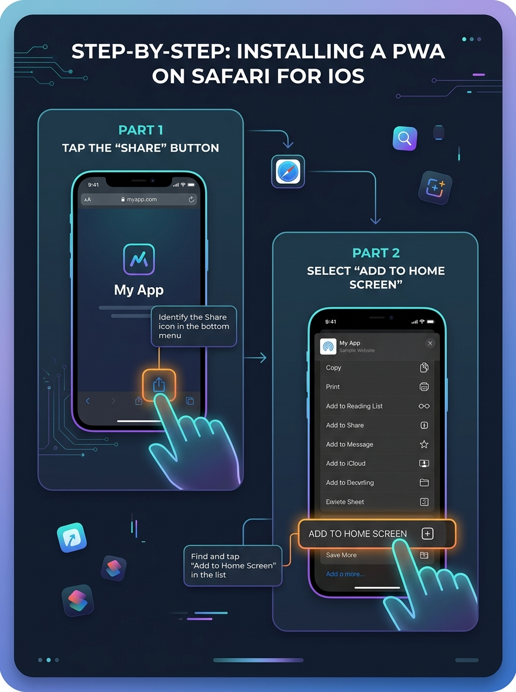
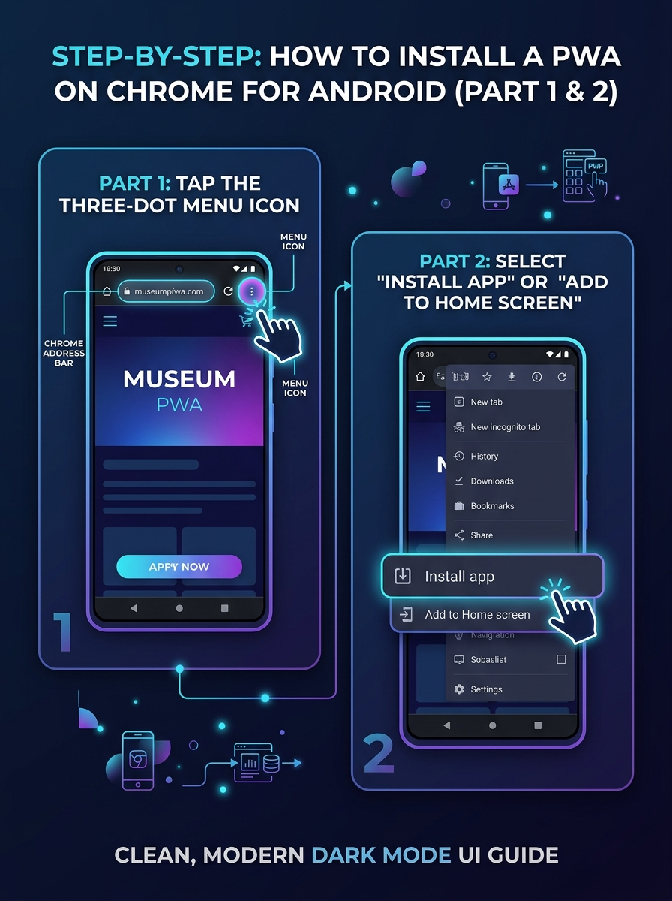

# User Guide: Sacred Fire Songs

**Version:** 2.11
**Status:** Published
**Date:** Nov 13, 2026

## Changelog

| Version | Date | Description of Changes |
| ----- | ----- | ----- |
| **1.0** | Dec 25, 2025 | Initial Document Creation. User guide for Guests, Members, and Admins. |
| **1.1** | Jan 10, 2026 | Changed project name to Sacred Fire Songs. |
| **1.2** | Jan 10, 2026 | Moved "Adding New Songs" to Member section. |
| **1.3** | Jan 10, 2026 | Refactored "Upload" terminology to "Add Song". |
| **2.0** | Jan 30, 2026 | Major update: Magic Link auth, .cho/.txt imports, Public/Private songs, and Advanced Filters. |
| **2.1** | Feb 02, 2026 | Rebranded "Private" songs to "Draft" and added advanced filter combinability. |
| **2.2** | Feb 23, 2026 | Removed Home page search box and renamed "Library" to "Search Songs". |
| **2.3** | Jun 27, 2026 | Added step-by-step PWA installation guides for iOS and Android with screenshots. |
| **2.4** | Nov 12, 2026 | Song page metadata: the meta line also shows the **Beats** of the selected version when its songbook gives them (Story 6.2.7, #510). |
| **2.5** | Nov 12, 2026 | Song Detail: a version with a note from its songbook shows **About this song** under the metadata line; tap it to read the background (closed at first). |
| **2.6** | Nov 12, 2026 | Song page: every author of a co-written song is shown as its own link and opens that author's songs; the share text names all authors. The search box finds a song by any of its authors. |
| **2.7** | Nov 12, 2026 | Song Detail: a song with translations has a **language switch** next to the version switch (Original language plus the languages the song has); tap a language to read that translation without leaving the song (Story 6.2.13, #516). |
| **2.8** | Nov 13, 2026 | The search box also finds a song by another name it is known by (an alias) and by the title it has in a songbook, ignoring capitals and accents. When the song's own title did not match, the result says why, for example *Matched by alias: …*. Songs whose title matches are listed first. |
| **2.9** | Nov 13, 2026 | Editing: the edit form has a **Songbook details** section with the **Beats** and the **About this song** note of the version, and shows its source (songbook, page, compiler) as read-only text; admins can correct the source's page and original title (UX v3, #523). |
| **2.10** | Nov 13, 2026 | Songbooks: **Library → Songbooks** lists the printed songbooks with their number of songs, and each book has a page that lists its songs in the order of its pages. The source line under a song's lyrics links to its book (UX v3, #514). |
| **2.11** | Nov 13, 2026 | Song Detail: **Key**, **Capo** and **Tuning** (now named, e.g. `Tuning: Drop D`) show only while the **Chords** switch is on; the **Beats** stay. Musicians transpose with the **− n +** stepper next to the Chords switch. |

Welcome to **Sacred Fire Songs**, a digital songbook designed for ceremonial musicians. This guide covers how to browse, learn, and manage medicine songs using our platform.

---

## 1. Authentication & Roles

### 1.1 Fast Sign-In (Magic Link)
The easiest way to sign in is via **Magic Link**. 
1. Enter your email addressed on the Sign In page.
2. Check your inbox for an email from "🔥 Sacred Fire Songs".
3. Click the link to be instantly logged in—no password required.

### 1.2 Password Access
If you prefer, you can also sign up or log in using a tradition **Email & Password** combination. You can manage your password or reset it via the "Forgot Password" link if needed.

### 1.3 User Roles
- **Guest**: Can browse and view all **Public** songs.
- **Member**: Can add their own songs, save songs as **Draft**, and edit/delete songs they own.
- **Admin**: Full access to manage all songs, users, and categories.

---

## 2. Using the Library

### 2.1 Browsing & Searching
The **Search Songs** page allows you to find songs quickly:
- **Search**: Search by title, another name the song is known by (alias), the title it has in a songbook, author, or even words within the lyrics. A co-written song is found by each of its authors. Capitals and accents do not matter ("pachamama" finds "Pachamamá"). When the title did not match, the result adds a grey line saying why, for example *Matched by alias: Gran Venerable Madre Tierra*. Songs whose title matches are listed first.
- **Sorting**: Toggle between **Alphabetical** (Title) or **Chronological** (Newest) order.

### 2.1b Songbooks
**Library → Songbooks** lists the printed songbooks. Open a book to see who compiled it and its songs in page order (`p. 2`, `p. 10`, `p. 12a`, songs without a page last); tap a song to open the version printed there. Guests see the public songs only; you also see your own private songs, marked with a lock. On a song page, the grey source line under the lyrics opens the book's page.

### 2.2 Advanced Filters
Use the filter tabs at the top to narrow down your selection:
- **🎸 Chords**: Show only songs that include musical chords.
- **🎵 Melody**: Show only songs that have a melody/audio reference.
- **🔒 Draft**: (Members only) View your personal drafts and unpublish songs.

### 2.3 Song Detail View
Click any song to view its lyrics and musical data:
- **Badges**: High-visibility badges tell you if a song has Chords or Melody.
- **Metadata**: See the **Key**, **Capo position**, **Tuning** (while chords are on) and, when the songbook gives them, the **Beats** of the selected version at a glance.
- **Language**: If the song has translations, a second switch next to the version switch lists **Original language** and the languages the song is available in (named in your app language). Tap a language to read that translation; tap **Original language** to go back. Choosing another version returns to the original language, and a link ending in `?lang=nl` opens the translation. Songs without translations show no language switch.
- **About this song**: If the songbook this version was printed in gives a note about the song, tap **About this song** under the metadata to read it. It starts closed and is not shown when there is no note.
- **Media**: Listen to YouTube, Spotify, or SoundCloud recordings directly on the page.

---

## 3. Managing Songs (Members & Admins)

### 3.1 Adding a Song
Click **"Add Song"** in the sidebar to contribute to the library:
- **Smart Import**: Drag and drop a `.cho` (ChordPro) or `.txt` file. The system will automatically detect the **Title**, **Author**, **Key**, and **Capo**.
- **Manual Formatting**: Use standard brackets like `[Am]` for chords. The system will automatically align them above the lyrics for you.

### 3.2 Public vs Draft
When saving a song, you have two choices:
1. **Publish Song**: Makes the song visible to everyone in the community.
2. **Save as Draft**: Keeps the song hidden from others. Only you (and Admins) can see it in your "Draft" filter.

### 3.3 Editing & Deleting
If you own a song (or are an Admin), you will see icons at the top of the detail page:
- **✏️ Pencil**: Edit the song details, lyrics, or visibility. For a song from a printed songbook the form also has **Songbook details**: the version's beats and its "About this song" note.
- **🗑️ Trash**: Permanently remove the song from the library (requires confirmation).

---

## 4. Offline Access (PWA)

Sacred Fire Songs is a Progressive Web App (PWA). Any song you view while online is automatically cached to your device. This ensures you can access your music in remote ceremony locations without an internet or cell connection.

### 4.1 How to Install on iOS (Safari Web Browser)

1. Open **Safari** on your iPhone and navigate to your deployed app domain (e.g. `https://your-songbook-app.com`).
2. Tap the **Share** button (the square icon with an arrow pointing up) in the bottom navigation bar.
3. Scroll down the share sheet and tap **Add to Home Screen**.
4. Confirm the name of the app and tap **Add** in the top right corner. The app icon will now appear on your home screen.

### 4.2 How to Install on Android (Google Chrome Web Browser)

1. Open **Google Chrome** on your Android device and navigate to your deployed app domain (e.g. `https://your-songbook-app.com`).
2. Tap the **Three-Dot Menu** icon in the top right corner of the screen.
3. Select **Install app** (or **Add to Home Screen** depending on your Android version).
4. Tap **Install** in the confirmation popup. The app will be added to your app drawer and home screen.

